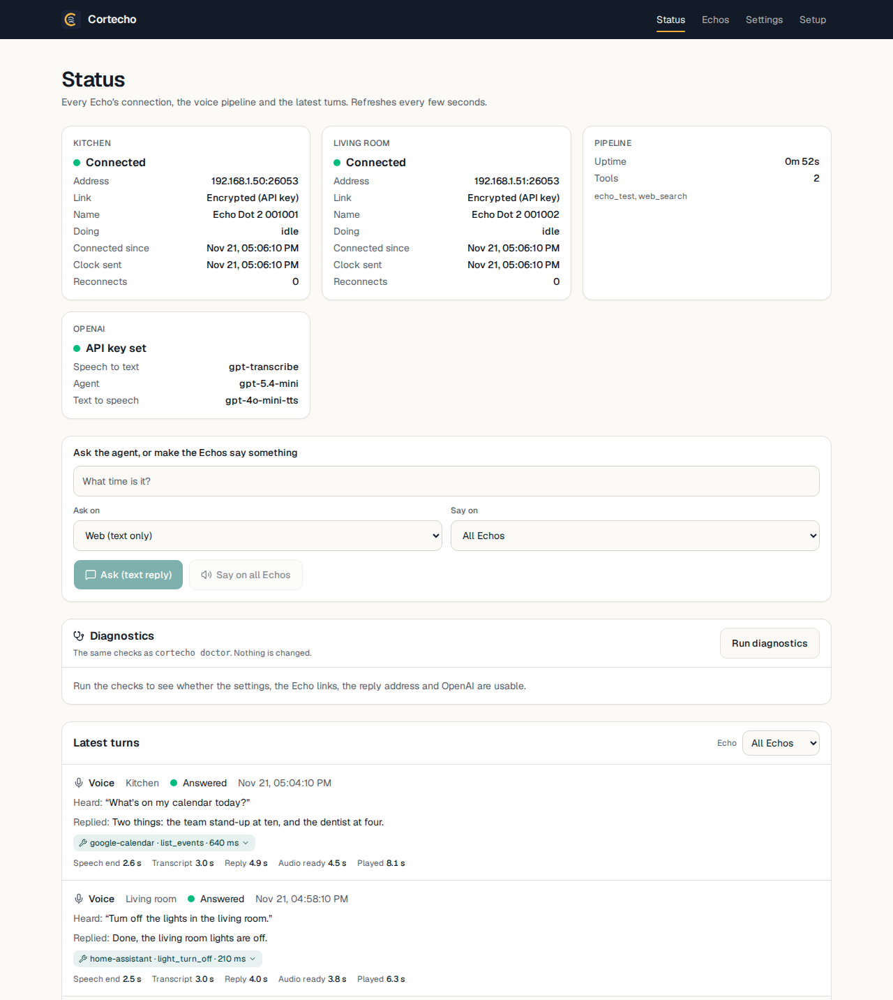
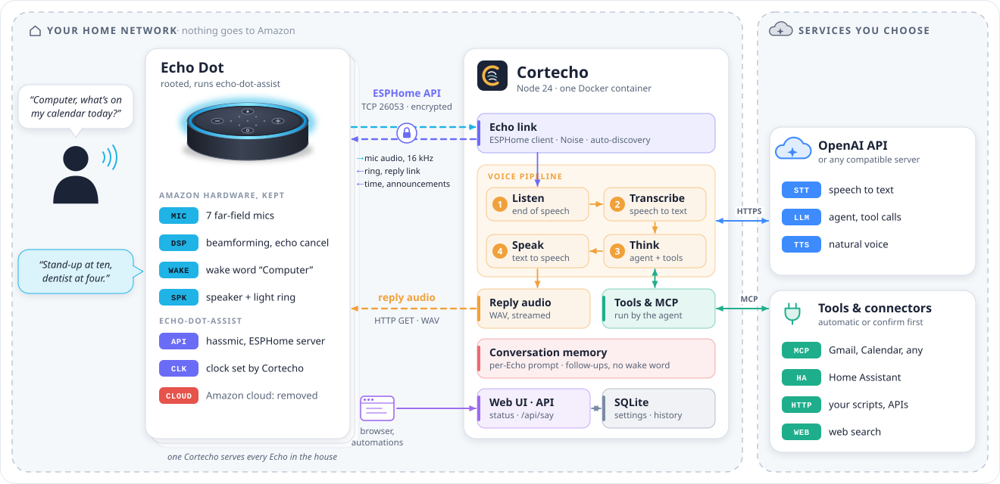
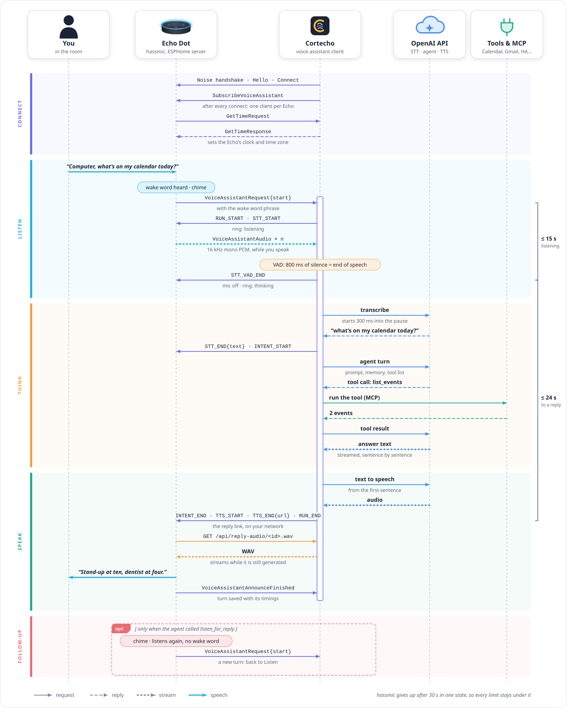

<picture>
  <source media="(prefers-color-scheme: dark)" srcset="docs/img/logo-dark.svg">
  
</picture>

# Cortecho

**A brain for your Echo Dot.** A DIY AI voice assistant for a rooted Amazon
Echo Dot, with no Home Assistant needed. Say the wake word, ask a question, get
a spoken answer from your own LLM agent with your own tools.

[](https://github.com/aformusatii/cortecho/actions/workflows/ci.yml)
[](https://github.com/aformusatii/cortecho/actions/workflows/docker-image.yml)
[](LICENSE)
[](https://github.com/aformusatii/cortecho/releases)

Cortecho is the missing piece for
[echo-dot-assist](https://github.com/Gamer92000/echo-dot-assist): that project
frees an Echo from Amazon, and Cortecho gives it a brain. It speaks the
ESPHome native API to `hassmic` on the device, turns speech into text (OpenAI
or ElevenLabs), runs an agent, and sends the answer back as audio (OpenAI or
ElevenLabs voices) the Echo plays. One instance can serve several Echos.



## Why an Echo Dot?

An Echo Dot is the best voice hardware you can get for the money. Amazon
designed it to hear a normal voice from across a room, with music playing: an
array of far-field microphones, Amazon's own audio processing, a wake word
engine tuned on real homes, a speaker, a light ring and a finished case. Used
ones cost roughly what a bare ESP32 microphone board costs, and those boards
have one or two microphones and no case.

`echo-dot-assist` keeps Amazon's microphone processing and wake word engine
while removing Amazon's cloud. Cortecho adds your own AI agent, your own tools,
and no Home Assistant.

| | **Echo Dot 2 + Cortecho** | ESP32-S3-BOX-3 | Home Assistant Voice PE | ReSpeaker 2-Mics Pi HAT + Pi | INMP441 + ESP32 |
|---|---|---|---|---|---|
| Microphones | **7 MEMS** [1][2] | 2 digital [3] | 2 [4] | 2 [5] | 1 [6] |
| Audio front end | **Amazon's** (beamforming, echo cancellation, noise reduction) [2] | ESP-SR [3] | XMOS XU316: echo cancellation, noise removal, AGC [4] | Software on the Pi | None |
| Wake word | **Amazon's engine** [2] | ESP-SR wake word [3] | microWakeWord [4] | Software (openWakeWord, Porcupine…) | None |
| Speaker | **Built in** | Built in | Built in | No | No |
| Case | **Finished** | Finished | Finished | No | No |
| Soldering | **None** | None | None | Header/solder depends on the kit | Yes |
| Typical price | **Used, about a dev board** | $49.95 [3] | $59–69 [4] | ~$15–25 + a Pi | ~$5–10 |
| Needs Home Assistant? | **No** | No, but you provide the firmware | **Yes** | No, but you provide everything | No, but you provide everything |

Prices and specifications were checked in November 2026; they change. Sources
are at the end of this file.

The honest costs: the Echo must be **rooted** (a one-time job, and a device can
be bricked), the default pipeline uses OpenAI's **paid API**, and you need a
machine on the same LAN to run one container. Rooting is the hard part, and it
is done once.

## What it does

- **Wake word to spoken answer**: "Computer, what time is it?" → transcript →
  agent → natural voice.
- **Pick the provider per stage**: speech-to-text and text-to-speech can each
  use OpenAI or ElevenLabs, in any combination: ElevenLabs Scribe or OpenAI
  gpt-transcribe/Whisper for speech-to-text, ElevenLabs or OpenAI voices for
  text-to-speech. Thinking stays on OpenAI.
- **Hear the voice before saving**: browse the ElevenLabs voices of your
  account with a sample each, or press **Listen here** to hear the draft voice
  (OpenAI or ElevenLabs) in the browser — no Echo needed. **Play on an Echo**
  speaks it through the real hardware.
- **A visual voice pipeline**: Settings shows Listening → Understanding →
  Thinking → Voice with the provider and model of each stage, updating as you
  edit and linking to each section.
- **Tools**: the model can call your scripts, HTTP endpoints, Home Assistant
  and a built-in web search.
- **MCP connectors**: connect Gmail, Google Calendar, Home Assistant or any MCP
  server in **Settings → Connectors**, choose which tools are automatic and
  which need a spoken yes, and limit them per Echo. No restart.
- **Follow-up questions** without repeating the wake word; the model decides
  when to listen again.
- **Announcements** over HTTP: `POST /api/say` speaks on one Echo or all of
  them (a doorbell, a finished backup, a reminder).
- **Several Echos**, each with its own prompt, memory and room-dependent
  settings.
- **A web UI**: live connection state, turn history and timings, all settings
  (no restart), per-Echo tunings.
- **A fake Echo** for development: the whole voice loop with no hardware.

## How it works

<picture>
  <source media="(prefers-color-scheme: dark)" srcset="docs/img/diagrams/architecture-dark.svg">
  
</picture>

The Echo keeps what Amazon does well (the microphones, the audio processing,
the wake word, the speaker) and loses the Amazon cloud. `hassmic` on the Echo
is an ESPHome server; Cortecho is its only voice assistant client. The link
is encrypted with the Echo's API key (Noise), which also lets Cortecho set the
Echo's clock. One Cortecho serves every Echo in the house.

### One turn, step by step

<picture>
  <source media="(prefers-color-scheme: dark)" srcset="docs/img/diagrams/turn-sequence-dark.svg">
  
</picture>

Cortecho ends listening itself, transcribes while you finish the sentence,
and starts speaking from the first sentence of the answer, so the reply plays
while the rest is still being generated. Understanding and Voice can each use
OpenAI or ElevenLabs (mixed freely); the Thinking step always uses OpenAI.
Every message is in [How a turn works](docs/protocol.md).

## What you need

- A rooted Echo with `echo-dot-assist` installed, in ESPHome mode, on the same
  LAN (see [Echo setup](docs/echo-setup.md)).
- A machine with Docker on that LAN, and a free port (default `3000`).
- An OpenAI API key for thinking (speech-to-text and text-to-speech can stay
  on OpenAI too), or an OpenAI-compatible server for the whole OpenAI side
  (see [configuration](docs/configuration.md#1-environment-only)). The key is
  entered in the UI during setup.
- Optionally, an ElevenLabs API key: then either audio stage can use ElevenLabs
  Scribe or ElevenLabs voices instead. Add it under **Settings → Providers**.
  Speech needs no special scope; the optional voice/model pickers use **Voices
  → Read** and **Models → Read** when the key has them.
- A little disk space for the image; the SQLite database is small.

## Quick start

### Run with Docker Compose

On the machine that will run Cortecho, create a folder for the app.

```bash
mkdir cortecho && cd cortecho
mkdir data
```

Save the following as `docker-compose.yml` inside the `cortecho` folder, or
download the [ready-made Compose file](https://raw.githubusercontent.com/aformusatii/cortecho/main/docker-compose.yml).

```yaml
services:
  app:
    image: ghcr.io/aformusatii/cortecho:latest
    ports:
      - "3000:3000"
    volumes:
      - ./data:/app/data
    env_file:
      - path: ./cortecho.env
        required: false
    restart: unless-stopped
    stop_grace_period: 15s
```

Cortecho keeps your settings and paired Echos in `./data`. The container runs
as UID 1000, so that user needs write access to the folder. Start the app from
the same directory.

```bash
docker compose up -d
```

Then open `http://<this-computer>:3000` and follow **Setup**. Cortecho finds
the Echo on your network, secures the connection with a key only Cortecho
knows, plays a sound on it and asks which room it is in. Say the wake word and
ask "What time is it?".

No file needs editing: the compose file works as downloaded, and the time
zone, the provider keys and the reply address are set in the UI. For the few
things that cannot be settings (an OpenAI-compatible server, connectors), copy
[`cortecho.env.example`](cortecho.env.example) to `cortecho.env` next to the
compose file and set only what you need. See [deployment](docs/deployment.md)
and [configuration](docs/configuration.md).

<!-- TODO: screenshot of the Discovered card on the Echos page (Add / Ignore),
     once docs/screenshots has one with the card itself, not the open dialog. -->

> **Important:** behaviour settings live in `data/app.db` and are edited in the
> UI (Settings, Echos, Setup). An environment file is imported into the
> database only on a fresh start; changing those values later does nothing.
> Only `OPENAI_BASE_URL`, `PUBLIC_BASE_URL`, `CORTECHO_SECRET_KEY`,
> `DISCOVERY_EXTRA_TARGETS` and the tool/MCP variables are read on every start.

### Run from source

```bash
git clone https://github.com/aformusatii/cortecho.git && cd cortecho
npm install
npm run dev     # API :3000 + web :5173
```

## Try it without an Echo

The repository includes a fake hassmic. It plays a WAV as a wake-word run and
downloads the answer:

```bash
# terminal 1: the fake Echo plays question.wav as a wake-word run
npm run fake-echo -- question.wav --port 26099 --out answer.wav
# terminal 2: the app, pointed at it (remove the DB so the import runs)
rm -f data/app.db*
ECHO_HOST=127.0.0.1 ECHO_PORT=26099 REPLY_AUDIO_BASE_URL=http://127.0.0.1:3000 \
  OPENAI_API_KEY=... npm run dev -w @cortecho/api
```

Add `--key <base64>` to the fake Echo and `ECHO_API_KEY=<same>` to the app to
exercise the encrypted link. You can also use the **Ask** box in the UI with no
Echo at all.

## Add your own tools

Tools live in `apps/api/src/tools/plugins/`. A new action is one file plus one
registration line:

```ts
// apps/api/src/tools/plugins/garage-door.ts
import type { Tool } from '../registry.ts';

export function garageDoorTool(url: string | undefined): Tool | null {
  if (!url) return null;                       // not configured → not registered
  return {
    name: 'garage_door_state',                 // snake_case, unique
    description: 'Says whether the garage door is open or closed.',
    parameters: { type: 'object', properties: {}, additionalProperties: false },
    // destructive: true,                      // changes the real world
    handler: async (_args, { signal }) => (await fetch(url, { signal })).json(),
  };
}
```

Register it in `tools/index.ts`, add `GARAGE_URL` to `config.ts` and the
documentation, and add a test. Tools marked `destructive` are hidden from the
model and refused unless their name is in `TOOLS_ALLOW_DESTRUCTIVE`. See
[development](docs/development.md#adding-a-tool).

For a service that already speaks MCP, there is no code to write: add it under
**Settings → Connectors** and choose its tools. See
[connectors](docs/connectors.md).

## FAQ

**Can I use an Echo Dot without Amazon?** Yes. `echo-dot-assist` roots the
device and replaces the firmware services; Cortecho is its local brain.
Amazon's wake word engine and microphone processing stay on the device, but no
audio goes to Amazon.

**Do I need Home Assistant?** No. Cortecho takes Home Assistant's place as the
Echo's voice assistant, and it has its own tools (including a Home Assistant
REST tool if you have one).

**Which Echo models work?** Only the Echo Dot 2nd gen is tested by this
project. `hassmic` is the same daemon on the other models echo-dot-assist
supports, so they will probably work; please report yours with the
device-report issue template.

**Does it work without the cloud?** The default pipeline uses OpenAI. The
OpenAI side is OpenAI-compatible: `OPENAI_BASE_URL` can point at a local
speech-to-text, LLM and TTS server that implements the Responses API and
streaming speech. ElevenLabs is a hosted alternative for the two audio stages,
not a local one. A tested, fully local recipe is still on the roadmap.

**What does it cost to run?** One turn is a transcription, one or more model
requests and one or two speech requests. With ElevenLabs selected those audio
calls are billed by ElevenLabs instead of OpenAI. The status page shows each
turn's timings; the provider dashboards show the bill. There is no
subscription.

**Can it control my smart home?** Yes, through the HTTP tool, scripts, or the
Home Assistant REST tool. Destructive actions need an explicit allow-list.

**Can I change the wake word?** Yes, on the Echo, with Amazon's models. See
[Echo setup](docs/echo-setup.md#wake-word).

**Can I go back to Alexa?** Yes: undo the echo-dot-assist installation and
re-register the device with Amazon. Cortecho changes nothing on the Echo.

**Is it affiliated with Amazon?** No. Cortecho is not affiliated with Amazon.
Amazon, Echo and Alexa are trademarks of Amazon.com, Inc.

## Documentation

- [How a turn works](docs/protocol.md)
- [Speed and measurements](docs/performance.md)
- [Configuration](docs/configuration.md)
- [Connectors (MCP servers)](docs/connectors.md)
- [Deployment](docs/deployment.md)
- [Echo setup](docs/echo-setup.md)
- [Troubleshooting](docs/troubleshooting.md)
- [Development](docs/development.md)
- [HTTP API](docs/http-api.md)
- [Set up with a coding agent](docs/setup-with-an-agent.md)
- [llms.txt](llms.txt)

## Tested devices

| Model | Firmware | Who tested | Date |
|---|---|---|---|
| Echo Dot 2nd gen (`RS03QR`) | Fire OS `NS65741`, echo-dot-assist at `2eebb42` | project author | 2026-11-08 |

Report another model with the **Device report** issue template. Cortecho needs
`hassmic` in ESPHome mode on TCP `26053`.

## Limits and roadmap

- **One container, many Echos.** Each Echo gets exactly one link. Pair the
  Echos with each other so only the nearest one answers.
- **The web UI has no authentication.** Keep it on a trusted LAN or put a
  reverse proxy with login in front.
- **`gpt-4o-mini-tts` shuts down on 2027-01-06.** Set a supported speech model
  before then, or wait for the Realtime API mode.
- **No timers, media player, light ring, Bluetooth or Drop In.** Cortecho
  subscribes only to the voice assistant.
- Roadmap: Realtime API mode, example tools (timer, weather, webhook), persona
  files, `stdio` MCP servers, MCP resources, a tested fully local recipe, and a
  device matrix.

## Related projects

- [echo-dot-assist](https://github.com/Gamer92000/echo-dot-assist) — the
  rooted-Echo firmware (`hassmic`) that Cortecho talks to.
- EchoMuse, TECHO5, linux-voice-assistant and the OpenClaw ESP32 bridge — other
  ways to put an assistant on voice hardware. Cortecho is the one that treats
  `hassmic` as the device and needs no Home Assistant.

## Credits

The Echo firmware and the root procedure are
[echo-dot-assist](https://github.com/Gamer92000/echo-dot-assist) by its
contributors; Cortecho is the standalone brain for it. The project started from
the `tpl-node-webapp` template.

Cortecho is not affiliated with Amazon. Amazon, Echo and Alexa are trademarks
of Amazon.com, Inc.

## Contributing

Read [CONTRIBUTING.md](CONTRIBUTING.md). Security reports:
[SECURITY.md](SECURITY.md). Changes: [CHANGELOG.md](CHANGELOG.md).

## License

MIT. See [LICENSE](LICENSE).

## Sources

1. [Teardown of the Echo Dot 2nd gen](https://predictabledesigns.com/product-development-teardown-of-an-amazon-echo-dot/) — seven MEMS microphones.
2. [echo-dot-assist](https://github.com/Gamer92000/echo-dot-assist) — keeps Amazon's microphone processing and wake word engine.
3. [ESP32-S3-BOX-3, Adafruit](https://www.adafruit.com/product/5835) — two digital microphones, ESP-SR, speaker, $49.95.
4. [Home Assistant Voice Preview Edition](https://www.home-assistant.io/voice-pe) — dual mics, XMOS XU316 with echo cancellation/noise removal/AGC, speaker, case; $59–69 at retailers.
5. [ReSpeaker 2-Mics Pi HAT](https://wiki.seeedstudio.com/ReSpeaker_2_Mics_Pi_HAT/) — two microphones, Raspberry Pi HAT.
6. [INMP441 datasheet](https://www.invensense.com/products/digital/inmp441/) — single digital microphone.
